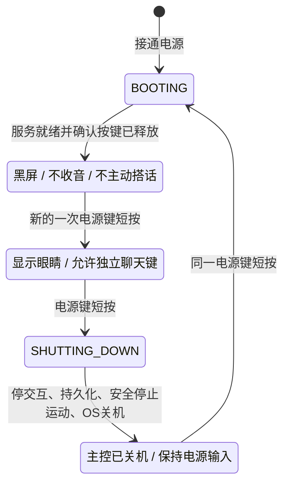
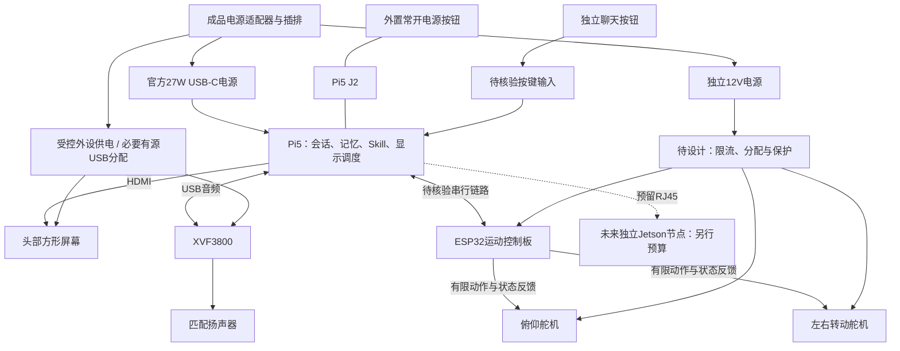

# 硬件台架、电源循环与分批放行

2026-11-01。配套[路线与预算报告](hardware-route-review-2026-11-01.md)。本文是**待执行设计**，没有硬件测试结果，也不是可直接照接的针脚接线图。当前预算与器件均为候选，采购前还需确认渠道和具体配件。

## 1. B-L 的电源循环

Pi5 的 J2 常开瞬时按钮等同机载电源键；接电可自动启动，系统关机但仍接电时可再次按键启动。因此可以先验证 **J2＋主机常驻按键服务**，不必为按钮本身再加一个常供 MCU。[官方电源键与启动说明](https://www.raspberrypi.com/documentation/computers/raspberry-pi.html#power-button)

官方 Pi5 设备树提供 `gpio-keys` 的 `KEY_POWER=116` 事件；这是内核定义，**不是让用户接到排针 GPIO20**。运行时用 logind 的 `HandlePowerKey=ignore` 或相应 inhibitor 接管默认动作，再由 Jarvis 按状态决定启用或关机；如有桌面组件，也须排除其默认关机弹窗。[内核设备树](https://github.com/raspberrypi/linux/blob/rpi-6.12.y/arch/arm64/boot/dts/broadcom/bcm2712-rpi-5-b.dts#L382-L394)、[systemd说明](https://www.freedesktop.org/software/systemd/man/latest/logind.conf.html#HandlePowerKey=)

这提供了实现依据，**尚未证明指定镜像上整个循环成立**；本次没有修改 Mac 或任何系统电源配置。

- 启动／关机期间忽略重复触发；不能把用于开机的同一次按压继续算作“启用交互”。
- 电源键和聊天键分开；正常操作不要求长按或二次确认。板载长按硬关断能力不是 Jarvis 的正常流程。
- 关机先停止新音频与动作，保存已完成历史及待提炼标记，再请求 OS 正常关机。保存失败要可见，不能用固定超时强切主机电源。
- 系统关机后保留电源输入；若采用 PMIC STANDBY，须核验 `POWER_OFF_ON_HALT=1`，并保持 `WAIT_FOR_POWER_BUTTON=0` 以保留接电自动启动。普通 OS 关机不自动等同于 PMIC STANDBY；应用退出也不算系统关机。启动时清除交互启用标志。
- 冷启动到未启用必须关屏，画黑色图像不能替代关背光。LCD(C) 厂商提供的 PWM 背光改法涉及焊接，旧命令示例也不能直接用于 Pi5；先验证默认关闭的背光门控，无法做到时换有明确背光控制的屏幕，并重算 BOM。[屏幕背光FAQ](https://docs.waveshare.net/4inch_HDMI_LCD_C_/FAQ/)

## 2. 功能连接图

图表示功能责任，不表示可把两路电源同时接入同一个器件。USB 是否既供电又传数据、如何做外部供电及防回灌，须按具体器件原理图冻结。运动配电不能把5.4A双轴异常电流全压在标称5A的驱动板上，也不能把12V／19V接到5V接口。

Pi5 官方说明：5A电源下，USB与风扇仍共享约1.6A供电额度。屏幕、音频功放、控制板须测峰值；更换有源集线器时检查反向供电和断电后的枚举行为。若使用持续供电的 ESP32，与已经关机的主机之间也要核验接口回供电。[Pi供电限制](https://www.raspberrypi.com/documentation/computers/raspberry-pi.html#power-supply)

## 3. 分批采购与验证，不一次买齐

本表都是未来步骤；当前用户无需再测一轮软件或购买。阶段金额包含在总 BOM 中，不能重复相加到总预算外。

| 阶段 | 准备／采购范围 | 放行依据 |
| --- | --- | --- |
| H0 路线和报价 | 选验证方向，核具体SKU、税运费、配件、退换与交期 | 完整预算≤5000；未冻结电气部分有明确处理路径 |
| H1 音频 | XVF3800、匹配扬声器、必要数据线／辅助供电；沿用Mac做第一轮音频台架 | 双向录放、回声参考、真实插话与旧声清空成立。不是要求换硬件来证明ASR词错已修 |
| H2 主控与电源键 | Pi5、SD、电源、散热、常开按键；先用现有显示器调试 | 目标Linux运行当前程序；5次完整电源循环；启动那次按压不直接启用 |
| H3 小屏 | 指定方屏、柔性视频线、门控件和轻支架 | 20–50cm字幕可读；冷启动不提前亮屏；关机后不亮“无信号”；供电无回灌 |
| H4 单轴 | 控制板、第一只舵机、电源、可固定的支架；先不装头 | 读回状态、限位、缓启、取消、失联；不靠手动堵转测试故障 |
| H5 两轴及承重 | 第二只舵机、配电、底板、轴承／加工件，称量头部 | 两轴供电容量、瞬态压降、重心、线材、关机支撑和缺轴降级通过 |
| H6 整机 | 所有外设合用的实际布置 | 对话／动作／显示协同、断网恢复、资源和温度记录；再进入PRD正式验收 |

H1 首批额度大致来自 BL07、BL08 与需要的 BL12／BL15，最多约940元；是否需全部辅助供电件以选定音频方案为准。H2 主机四项约1680元。**这些仍不是下单清单**，须先有具体渠道和配件核对；台架不过时先定位，不自动追加购买另一整套路线。

## 4. 每个门槛如何验证

| 验证 | 操作与记录 | 不得误算为通过 |
| --- | --- | --- |
| 版本固定 | 记录主板批次、OS镜像、内核、EEPROM、Node、屏幕和音频／控制固件版本 | “最新版应该都能用” |
| 收音／外放 | 20–50cm，中英各一段；记录设备ID、实际采样率、输入声道、音量、DSP／浏览器处理开关 | 只枚举到USB设备；耳机能用就视为本体外放通过 |
| 插话／自身回声 | 按AC-05做10次，目标至少9次1秒内停旧音频；覆盖回答刚开始和长回答 | 按页面打断按钮替代直接插话；回声导致自己和自己聊 |
| 电源循环 | 按AC-01至少5次；冷上电、正常关机、再次开机到未启用、再次启用；另查连按和启动按键释放 | 屏幕黑了但OS仍运行；关机按钮只是关闭浏览器 |
| 存储 | 关闭前有完成文字及待提炼任务，正常关机后重启检查；提炼联网恢复且不重复 | 用强切电源当正常测试；摘要文字声称保存就算落盘 |
| 显示 | 720×720设置、眼睛＋两行中英文字；待机、启动、关机、失去视频信号分别观察 | 4英寸对角线当成4英寸宽度；只显示黑色但背光发亮 |
| 运动与配电 | 实测头重／重心；小角度标定；记录供电和反馈。安全解除通信后不回放积压动作 | 用目标角代替实测角；用额定堵转力矩代替连续负载；人为卡死舵机 |
| 结构／外壳准备 | 保存尺寸、孔位、接口朝向、可拆固定、线材余量、散热禁区、两轴最大安全包络 | 先买外壳再塞器件；线材拉力由屏幕接口承担 |
| 可靠性 | 先做短台架连续运行，再完成PRD AC-19的8小时混合运行 | 短时间开机替代8小时验收；软件模拟替代目标硬件 |

本轮没有新增正式验收指标；以上沿用 PRD 的相关目标，台架步骤用于发现选型问题。

## 5. A2 如果优先，必须先通过的额外门槛

1. 确认K151屏幕批次与固定固件可构建／可恢复；新屏支持不能仅凭旧README判定。
2. 改进并验证USB Dock物理层的同时收放、AEC与取消确认；协议已有双向PCM不等于全双工。
3. 验证拔插、重连、过期流、预缓冲对1–3秒回应目标的影响；记录PC桥和设备两端事件。
4. 单键同时管理K151与Linux主机，先保存再关机，断电后仍有开机路径；不能把主机常开藏在“机器人关机”里。
5. 2英寸屏字幕可读性、成品自带摄像头／电池的需求差异由用户明确接受。V1仍不启用视觉或增加续航验收。

未通过这些门槛时，不砍掉直接插话来迁就半双工固件。B-L亦须实测自身音频和电源，不能把A2的缺口当作B-L已经通过的证明。
