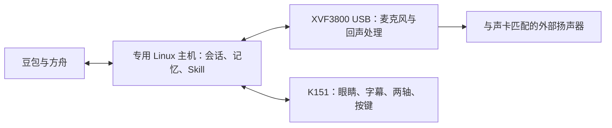

# Jarvis 新增硬件路线：开源项目与成品扩展调查

> 11-07 复核后，Deskman 已确认有预装整机，小木有并行收音和播放的源码。现行判断见[整机交付与全部方案购买清单](hardware-options-and-shopping-list-2026-11-07.html)。

核查日期：**2026-11-05（Asia/Shanghai）**。本轮用于扩大硬件候选，不是采购清单或实机验收。原 A1、A2、B-L、B-J 保留；下文 C1～C6 是本报告新增编号，与早期 PRD 的旧“方案 C＝Jetson”无关。

后续同日已整理[全部10条主路线与独立购买清单](hardware-options-comparison-and-shopping-list-2026-11-05.md)（[带目录阅读版](hardware-options-comparison-and-shopping-list-2026-11-05.html)），补齐小木编程版价格、不同型号配件和生产资料缺口；本文保留项目发现与筛选依据。

## 1. 本轮改变了什么判断

**现在不宜只在 K151 与完全自建之间选择。** 本轮新增了六条值得比较的路线：成品身体配独立音频、已有全双工代码的开源终端、集成屏幕音频的 Linux 扩展板、完整开源结构复用，以及两种可编程 Linux 机器人。

此前建议优先 B-L，依据是已核查 K151 社区桥的录放互斥、新屏适配缺口，以及自建可以明确选择 USB AEC 音频。现在发现 OpenDeskBot 有更完整的回声参考和取消播放代码，Reachy Mini 已集成 Linux 与 XVF3800 音频，值得重新比较。**这些发现没有证明 A2 硬件做不到，也没有证明任何新方案已经满足 Jarvis。**

建议优先补证据：**C1 的成品身体复用、C2 的音频与装配可复制性**；B-L 继续作为需求匹配和工作量的比较基线。C5 只有在愿意调整脸屏需求时才进入同一轮决策。这里是资料核查优先级，不是性能排名或最终选型。

## 2. 调查范围与判断方法

检索覆盖 GitHub、项目官方文档和商店、嘉立创开源广场、华秋电子社区、Hackster、Hackaday、作者博客及 Reddit 等技术社区。论坛用于发现项目和复现问题，关键规格尽量回到作者源码、硬件文件或厂商说明。本轮不声称穷尽全网，也不把搜索不到某接口理解成它一定不存在。

重点检查六件事：

1. 能否保留自主开发和本地历史、记忆、Skill，不依赖日常 Mac 常开。
2. 是否有同时收放、回声参考、AEC、插话取消与清空旧音频的证据。
3. 是否覆盖脸屏、少量字幕、点头和固定底板上方的左右转动。
4. 实际减少的是结构设计、焊接、驱动还是音频开发，哪些工作只是转移了。
5. 能否接现有豆包 Seeduplex 与方舟；默认支持某个云平台不等于已经适配本项目。
6. 整机到手价、供电、开关机、摄像头及未来独立 Jetson 节点扩展。

本文区分“官方说明”“源码存在”“作者展示”与“我们实测”。**本轮没有设备在手，没有编译、烧录或测量声学性能。** 特别是“支持全双工”不能直接替代自然插话验收。

## 3. 新增候选总览

六项的层级不同：C5/C6 是整机底座，C2 是开源交互终端，C1 是我们提出的组合，C3/C4 是对 B-L 等自建路线的模块或结构优化。它们不是六种成熟度相同的现成商品。

| 新路线 | 具体组合 | 能减少的工作 | 仍要承担的主要工作 | 现阶段结论 |
| --- | --- | --- | --- | --- |
| **C1 成品身体＋独立音频** | K151 只负责脸、动作和按键；专用 Linux 主机直接接 XVF3800 与匹配扬声器 | 保留成品两轴结构，绕过 K151 音频桥 | 屏幕／动作协议、外置音频布局、双系统电源；仍是小屏 | **优先核查**；这是我们提出的 A2 派生组合，不是搜到的现成套装 |
| **C2 OpenDeskBot 终端＋Linux** | ESP32-S3 两轴机器人＋专用主机；参考下文两个独立实现 | 可复用结构、电路、设备音频前端和终止播放协议 | 制板／装配或寻找代工，主机适配、豆包接入、字幕与电源改造 | **优先核查**；源码音频证据有价值，现成成品供应未确认 |
| **C3 Whisplay 集成板＋两轴** | Raspberry Pi＋HAT或HAT+＋另配两轴机构 | 减少屏幕与声卡的分散接线，已有 Linux 驱动与语音例程 | 软件 AEC 调试、两轴结构、载荷、GPIO与供电、Jarvis接入 | **模块优化备选**；优先研究2.8英寸HAT+，普通版仅1.69英寸 |
| **C4 VerdiBot 结构复用** | 参考“阿荫”的 Pi、PCB、3D 文件，裁剪为所需两轴 | 不必从空白设计全部结构和电路 | BOM核对、打板焊接、舵机板改装、裁剪结构、音频验证 | **设计参考优先**；没有核到稳定供货的即用成品 |
| **C5 Reachy Mini Wireless** | 自带 CM4、音频与动作机构的可编程机器人套件 | 省去主机／音频／机械从零选配，已有 SDK | **没有脸屏**；豆包适配、国内到货、按键电源和扩展核验 | **有条件候选**；需先明确脸屏取舍 |
| **C6 森灵小木编程版** | 国内可编程 Linux 成品，使用原始音频和动作 API | 有望免除大部分本体装配 | 自定义流式音频／停播／AEC／字幕及替换主程序的权限尚不明确 | **待补接口证据**；“编程版”不等于全栈自主 |

## 4. 六条路线的具体分析

### C1：保留 K151 身体，把声音独立出来

K151 的两轴与显示可编程；XVF3800 有标准 USB 音频及回声处理路径。这使“成品身体”和“声音链路”可以分别验证。这是架构推导，尚未实现整套桥接。[K151 官方资料](https://docs.m5stack.com/en/StackChan)、[XVF3800 接入资料](https://wiki.seeedstudio.com/respeaker_xvf3800_introduction/)

**对本项目最大的价值：可以不等待 K151 上的实时音频固件改好，就保留现成身体。** Linux 程序仍需实现音频接入与事件协调；把语音旁路也不会自动完成屏幕和动作控制。

限制必须一起看：

- 外部声卡配外部匹配扬声器，播放参考走同一音频链路；不能未经适配再把 K151 内置喇叭当默认输出。
- K151 新旧屏批次、2 英寸字幕与命令协议仍需验证。独立音频消除的是音频桥阻塞，不是所有 A2 风险。
- 仍有两个控制系统和多个供电负载；同键保存关机／再次开机不会自动解决。
- 声卡和扬声器可放固定底座或独立小盒，减少运动头部重量；这是布局提案，不是已做好的 CAD。
- 若继续放大屏或改造头部，会逐渐接近 B-L，失去复用成品机械的收益。

预算只作增量试算：沿用 11-01 A2 的 **3390–3790 元占位**，加入 B-L 声卡与扬声器 **660 元占位**，得到 **4050–4450 元**。两项均不是今日到手报价；新增安装、电源调整和可能的配件替换尚未重算，不能保证最终低于 5000 元。[原预算分项](hardware-route-review-2026-11-01.md)

### C2：OpenDeskBot，已有全双工代码的开源机器人终端

本轮找到两个名称相近但不能混用的仓库。它们均可作为“机器人端处理音频和动作，专用主机保留 Jarvis 业务”的基础；目前没有核实可直接购买的整机供应。

| 项目 | 已核查版本与传输方式 | 音频证据 | 主要边界 |
| --- | --- | --- | --- |
| [OpenDeskBot/brufik_in_one_v2](https://github.com/OpenDeskBot/brufik_in_one_v2) | `39b408019bfe4d63e39ff71e6bd42a8fe602c716`；Wi-Fi WebSocket `/asr_chat`，16k 上行、24k 下行 | 启动尝试 ESP-SR AFE，AEC开启；播放时继续喂麦；播放 PCM 进入参考通道；存在取消和队列清理 | 初始化失败会退回原始麦克风；仍需测 Wi-Fi、内存、回声和打断延迟 |
| [tudoom/OpenDeskBotV2](https://github.com/tudoom/OpenDeskBotV2) | `1cf5050ee63b1fe4cae6b7815e565a0955f15bd6`；USB CDC／DBOT v1 优先，也有局域网 TCP | 有 AEC、参考音频和紧急清队列代码；不能概括为所有模式均启用 AEC | **保存过 Wi-Fi 配置后，启动会跳过 AFE，以让出内部 RAM**；未配网 USB 路径与无线路径必须分开评价 |

关键源码可复查：

- brufik 的 [AEC 配置](https://github.com/OpenDeskBot/brufik_in_one_v2/blob/39b408019bfe4d63e39ff71e6bd42a8fe602c716/hardware/firmware/audio_frontend_esp_sr.cpp#L999)、[启动](https://github.com/OpenDeskBot/brufik_in_one_v2/blob/39b408019bfe4d63e39ff71e6bd42a8fe602c716/hardware/firmware/deskbot_rom.ino#L72)、[持续采集](https://github.com/OpenDeskBot/brufik_in_one_v2/blob/39b408019bfe4d63e39ff71e6bd42a8fe602c716/hardware/firmware/mic.cpp#L308)、[播放参考](https://github.com/OpenDeskBot/brufik_in_one_v2/blob/39b408019bfe4d63e39ff71e6bd42a8fe602c716/hardware/firmware/speaker.cpp#L198)、[播放状态机](https://github.com/OpenDeskBot/brufik_in_one_v2/blob/39b408019bfe4d63e39ff71e6bd42a8fe602c716/hardware/firmware/pb_runtime.cpp)。
- tudoom 的 [已配网时关闭 AFE](https://github.com/tudoom/OpenDeskBotV2/blob/1cf5050ee63b1fe4cae6b7815e565a0955f15bd6/hardware/firmware/deskbot_rom.ino#L142)、[音频输出与清理](https://github.com/tudoom/OpenDeskBotV2/blob/1cf5050ee63b1fe4cae6b7815e565a0955f15bd6/hardware/firmware/audio_player.cpp)。

**为什么值得新增：** 与之前已核查的 K151 社区半双工桥相比，这里不只是宣传“可以语音聊天”，已有比较完整的声学前端和中止播放代码，可减少从零探索的工作。但这只是实现证据，尚无我们的构建与实测结果。

brufik 提供两块 PCB、STEP、物料和接线资料，使用约 1.83 英寸屏幕与两个小舵机；复制仍涉及制板、焊接或代工及打印装配。屏幕硬接的背光设计也要核对 Jarvis 冷启动黑屏要求。不能把作者“百元级”的描述当成包含专用主机、加工、电源和返工的完整售价。[硬件资料](https://github.com/OpenDeskBot/brufik_in_one_v2/blob/39b408019bfe4d63e39ff71e6bd42a8fe602c716/hardware/README_zh.md)

同日采购资料复核发现：两份XLSX BOM可读，但README链接的Base Gerber ZIP在固定提交返回404，仓库树未找到该ZIP或LCM独立Gerber。应先取得匹配成板或完整生产包，不能把有BOM/板图当作可以立即下单PCBA。[详细缺口与分项](hardware-options-comparison-and-shopping-list-2026-11-05.md)

tudoom 有桌面服务与豆包 ASR／TTS 接入说明，但这不是现有 Seeduplex 会话的直接替换；Windows／macOS 发布也不等于 Linux 主机部署已经验证。应保留 Jarvis 的业务逻辑，单独评估设备协议适配；不为了复用外壳，整套改换已经验证过的语音与记忆系统。

**进入采购讨论前还差：** 固定工具链可构建、PCB与固件版本对应、可获得的成板/代工报价、AEC启动可见且不静默退化、两轴标定与故障隔离、按键与供电设计。若只能大量手工焊板，C2 对你节省时间的吸引力会下降。

### C3：PiSugar Whisplay，减少零散板卡的半自建方案

Whisplay 把屏幕、音频、按键等集中在扩展板上，官方提供 Linux 驱动及多种应用。可在 Pi 上继续运行 Jarvis，补一套两轴机构；它本身不是完整双轴机器人。两种板子必须分别评价：

| 型号 | 官方信息 | 对本项目的意义 |
| --- | --- | --- |
| 普通 Whisplay HAT | 1.69英寸240×280 SPI屏；V1为WM8960、V2为ES8389；挂牌US$35.99 | 体积小，字幕空间有限；需接其显示驱动，不能把现有网页原样送给SPI屏 |
| Whisplay HAT+ | 2.8英寸480×640 DSI触摸屏、ES8389、按钮、Grove；挂牌US$49.99 | 比普通版更值得研究字幕；支持64位Pi OS桌面方向，但仍不是约8×8cm方屏 |

来源：[普通版文档](https://docs.pisugar.com/docs/product-wiki/whisplay/overview)、[普通版商品](https://www.pisugar.com/products/whisplay-hat-for-pi-zero-2w-audio-display)、[HAT+文档](https://docs.pisugar.com/docs/product-wiki/whisplay-plus/overview)、[HAT+商品](https://www.pisugar.com/products/pisugar-whisplay-hat-plus-touchscreen-for-raspberry-pi-5)。商品页静态内容同时出现售罄和加入购物车，故不认定现货或可发中国；HAT+包装清单未列扬声器，需另核。

语音实现要分清：普通 HAT 的 `whisplay-chatgpt` 使用 **PipeWire/WebRTC 软件回声消除**，不是板载专用硬件 AEC；不能把该项目效果直接当作 HAT+ 已验证。`whisplay-xiaozhi` 的插话配置默认关闭，还要调能量阈值与回声预热。[语音实现](https://github.com/PiSugar/whisplay-chatgpt)、[小智配置](https://github.com/PiSugar/whisplay-xiaozhi/blob/main/.env.template)

优先按 Pi 5 研究，不能用 Zero 2 W 跑通示例证明当前 Node／浏览器、软件 AEC 与记忆任务性能足够。普通 HAT 的总线占用、HAT+ 的 DSI/驱动、舵机控制和电源应分别规划。HAT+自定义内核驱动还带来系统升级兼容工作。云服务需接回豆包；现成 OpenAI 示例不代表中国家庭网络需求已经满足。

[现有外壳文件](https://github.com/PiSugar/suit-cases/tree/main/pi5-whisplay-chatbot)可供布局参考，但不能当双轴机构，也不能跨HAT/HAT+直接套用。若一体板使主控也随头部运动，须重新核承重、散热和走线，不能以少几根线推定机械更简单。

### C4：VerdiBot“阿荫”，复用整套结构设计

VerdiBot 提供 Pi 5／Zero 2 W 方向、3D 结构与硬件资料，包含显示扩展、USB音频/Hub及改装舵机板。最值得复用的是器件布置和可制造结构，而不只是表情动画。[仓库](https://github.com/maker-community/VerdiBot)、[PCB 制作说明](https://verdibot.verdure-hiro.cn/zh/hardware/pcb-manufacturing.html)

**文档仍有实质缺口：** BOM 标题注明待补全，前后出现不同屏幕与音频方案；其估算还排除了 PCB，不能拿来证明当前成品多少钱。复制前必须把结构版本、电路版本、屏幕和音频方案对齐。[BOM 原文](https://verdibot.verdure-hiro.cn/zh/hardware/bill-of-materials.html)

若能取得已焊好的板件和与之匹配的打印件，它可能减少结构探索；若全部自己打板、改舵机和排查装配，可能比 B-L 采用现成模块更费时间。原设计多于 Jarvis 所需两轴，删去手臂等结构也需要重新核对载荷与走线。当前没有足够证据把它列为“购买即用”的替代品。

### C5：Reachy Mini Wireless，自带 Linux 与 AEC 的机器人套件

当前官方 Wireless 硬件是 **CM4 4GB／16GB**，有多自由度头部、身体转动及天线；音频基于 **XVF3800 四麦阵列**，官方明确默认启用 AEC。已有 Python／JavaScript SDK。这是本轮很有价值的完整集成路线。[硬件表](https://huggingface.co/docs/reachy_mini/platforms/reachy_mini/hardware)、[AEC 文档](https://huggingface.co/docs/reachy_mini/platforms/reachy_mini/media_advanced_controls)、[SDK 与许可说明](https://huggingface.co/docs/reachy_mini/index)

但它**没有用于眼睛动画与字幕的脸屏**。接受其机械表情是产品方向的改变；加装屏幕又涉及负载、结构和供电，不能默认属于低成本改造。它也有当前不需要的电池、摄像头与多轴，开源硬件设计含非商用许可条件，软件与硬件许可应分别看。

价格本轮为 **Wireless US$499、Lite US$399**。Wireless 不需要再为核心业务增加专用 Pi；Lite 若另加主机，须重新算整机费用。Pollen 页面写发货最长90天，Seeed页面显示有库存，两者不能替代中国收货地址的最终交期核实；90天情形会影响 2027-01-23 目标。[厂商产品页](https://pollen-robotics.com/reachy-mini/)、[Seeed Wireless 商品](https://www.seeedstudio.com/Reachy-Mini-Wireless-Kit-p-6724.html)

集成 AEC 是正向证据，但自主接豆包、取消播报、同键电源循环、国内首次安装和更新、未来有线 Jetson 连接仍需检查。不能因为有 SDK 就承诺原软件无需适配。若脸屏可以调整，它应进入重点评估；若脸屏保留，它不与 B-L 直接等价。

### C6：森灵小木编程版，可编程成品但接口仍需核清

官方仓库提供 Linux SSH、Python／ROS2 示例、16k单声道麦克风数据，以及点头、摇头等动作接口。相比只有 MCU 的 K151 单机，这确实是另一类有机会运行本地业务的成品底座。[官方 API 仓库](https://github.com/TimuTechnology/senling-xiaomu-ros2-api-examples)

本轮没有证明以下能力：任意 PCM 流式输出、立即停播、同时录放的 AEC、自定义字幕、停用原主程序后独立保留硬件驱动、Node与存储可用资源。文本 `/speak` 示例不能代替这些底层能力；仓库许可文件与 README 的权利说明也应进一步核对。

同日进一步查到独立编程版商品页，官方搜索索引为 **US$380**；原 **US$330** 对应标准版，不能混用。包装列整机、磁吸底座和USB-C充电线，未列墙插适配器；中国最终价格、发货与接口能力仍待确认。[编程版商品](https://www.timuai.com/order/code)

它值得补接口资料；若只有高层动作／播报 API，而不能掌握完整音频与会话进程，就不适合作为自主 Jarvis 主平台。

## 5. 其他项目为什么没有列为优先路线

| 项目与一手入口 | 本轮识别到的用途 | 没有优先采用的原因 |
| --- | --- | --- |
| [Echo-Mate](https://github.com/No-Chicken/Echo-Mate) | RV1106 Linux、256MB DDR、LVGL与音频/显示集成 | 是紧凑嵌入式参考；没有核到所需两轴成品，现有 Node/浏览器部署与 AEC 也未证明。构建主机用 Ubuntu 不代表机器人运行完整 Ubuntu |
| [Deskman](https://github.com/tjacobs/deskman) | Pi／Jetson、语音、表情与舵机分层 | 11-05 初判为软件参考。11-07 已确认原厂出售预装整机，按新报告核价 |
| [Doly](https://doly.ai/developer/) | CM4、Linux、眼睛显示、可替换应用与SDK | 轮履及手臂结构偏离固定两轴。官方说明可同时收放，但无硬件 AEC，原软件 AEC 不暴露给 SDK；自研仍需补。[音频 FAQ](https://github.com/robotdoly/DOLY-DIY/blob/main/SDK/docs/AI_Integration_Developer_FAQ.md) |
| [T5-DeskBot 作者发布](https://p.eda.cn/d-1429900873286287360) | 涂鸦 T5、2英寸屏、双SG90，集成设计方向 | 新近设计文件与描述不能证明成品可稳定复现；未核到完整售价。接 TuyaOpen 不等于 Jarvis 自主音频链已适配 |
| [DooiRobot 作者硬件](https://oshwhub.com/huochaigun/dooirobot) | 国内小型机器人复制思路 | 整体固件自主权、声音链路与所需关节未核清；作者复刻费用不能当商家成品报价 |
| [LAFVIN Desktop AI Gimbal Robot](https://lafvin-desktop-ai-gimbal-robot.readthedocs.io/en/latest/Introduction.html) | 已列双舵机及金属/亚克力件的教学套件 | 0.96英寸屏偏小；资料说明18650不随附、USB用于烧录/充电，不应假定无电池插电满足原要求；自主流式音频/AEC证据未补齐 |
| [Waveshare Pan-Tilt HAT](https://www.waveshare.com/product/modules/motors-servos/pan-tilt-hat.htm) | 可买的双轴轻载机构，US$17.99仅云台与控制板等 | 是 B-L/C3 可用的零件候选，非完整机器人；没有证明能承载原4英寸头部，反馈和故障保护仍需补。[厂商文档](https://www.waveshare.com/wiki/Pan-Tilt_HAT) |
| [m5-robot-companion](https://github.com/regitxx/m5-robot-companion) | K151/CoreS3 主机桥与动作工具参考 | README明确其语音为轮流录放，不支持全双工/AEC/语音插话，不能用来宣称 A2 音频问题已解决 |
| [DinoDesk](https://github.com/google-gemma/dinodesk-ai-companion) | Pi 显示、音效与本地AI交互参考 | 未核到目标两轴与自然插话链路，不是可以直接替换的机器人本体 |
| [ESP-VoCat 作者案例](https://www.hackster.io/davidmonterocrespo24/cute-desktop-robot-esp-vocat-eyes-with-gemini-live-cdb50b) | 集成语音屏幕和眼睛交互参考 | 示例云端/机械配置与 Jarvis 不同，尚缺完整双轴及国内 Seeduplex 接入证据 |
| [Mini Pupper 2](https://mangdang.store/products/mp2) | 成品四足机器人平台 | 结构和费用集中在行走；本项目不需要，不能仅因开源就优先 |
| [pib](https://pib.rocks/faq/)、[NICO](https://www.inf.uni-hamburg.de/en/inst/ab/wtm/research/neurobotics/nico/technical-details.html) | 大型开源/研究机器人 | 尺寸、复杂度或费用偏离桌面双轴与5000元目标 |
| [Acrobot Workshop Bot](https://github.com/hapiel/workshop_bot) | 动作表达和机械设计参考 | 杂技动作平台，未构成所需的语音／脸屏／记忆机器人 |
| [RoPet/KAMOMO](https://ropetai.com/products/ropet%E2%84%A2-ai-comfort-companion-plush-robot) | 消费级陪伴成品 | 本轮未找到满足自主替换系统的公开完整入口；不能拿能聊天等同于可自主开发 |
| [M5Stack Tab5](https://docs.m5stack.com/en/core/Tab5) | 大屏、声音与机壳集成的MCU开发终端 | 单机不能原样跑现有Node；加Linux后仍需音频桥及两轴。属于换终端的A2式探索，不是已省去音频开发 |
| [Android deskbot](https://github.com/SathiyaSenpai/deskbot)、[owlbot](https://github.com/Aaronminer1/owlbot) | 手机主控与外部电机的实验路线 | 未核到完整匹配的双轴套件；后台保活、设备AEC、严格电源循环和具体手机型号仍缺证据 |

Doly 本轮商店显示 **CAD$569（1GB/32GB）**，币种是加元，不是美元；开发者推荐的2GB配置尚未核价，因此不拿此数字作最终 Jarvis 配置预算。[商店](https://shop.doly.ai/products/doly)

检索中的未验证宣传、聚合榜单及失效链接不用于确定最终价格或证明技术能力。上述表格是筛选记录，不表示已全面审计每个仓库。

## 6. 预算与投入怎么公平比较

| 路线 | 当前能说的成本 | 不应漏算的项目 |
| --- | --- | --- |
| B-L基线 | 11-01分配4565元；有[工作量明细](bl-work-breakdown-2026-11-02.md) | 尚未核最终结算与实测返工 |
| C1 | 旧占位相加4050–4450元，非新报价 | 新音频固定／供电调整；不能双算已有余量，也不能用余量隐藏缺件 |
| C2 | 未取得完整可复制 BOM 的到手价 | Linux主机、两块PCB制板/贴片、打印、舵机、电源、线材、试错；不能用“百元级”替代总价 |
| C3 | HAT US$35.99或HAT+ US$49.99，仅部件价 | Pi／存储／电源、扬声器随货范围、两轴及加工、软件 AEC 适配 |
| C4 | 原项目 BOM 未完整、版本待统一 | PCB/焊接、改舵机、打印与版本调整；旧物料估价不沿用 |
| C5 | Wireless US$499；不再额外加一套Pi作为必要主控 | 税运和中国交付；如加脸屏则是另一个需重新评估的改造方案 |
| C6 | 编程版官方索引US$380，最终订单价未核 | 开放接口、电源/所需外围和国内交付条件 |

外币保留原币种，不用未核实汇率给出看似精确的人民币整机价格。当前只有预算约束，尚没有新候选的完整采购报价。

本轮也不为新候选编造开发天数。B-L 明细中大量会话、搜索、记忆、验收工作是各路线共用的；成品主要减少本体装配，未必减少软件适配。应拿新候选对应的硬件工作包逐项替换，不能把 B-L 全部剩余工时当成其他路线可以节省的时间。

## 7. 下一轮核查的具体顺序

1. **C1 先核接口，不先购买整套。** 确认 K151 新屏匹配固件、双轴与字幕命令、按键事件和掉线停止；同时复核独立音频布局与完整预算。适合“保留成品外观、接受旁边一台小主机和音频模块”的偏好。
2. **C2 先核可复制性。** 分别冻结两仓库的硬件/固件版本；尝试构建与审查设备协议，再核成板、打印件和装配报价。重点验证 AEC 实际运行、播放中继续收音、插话后物理停播、断链不重播旧音频。tudoom先限定未配网USB路径，brufik另测Wi-Fi与AFE共存。
3. **C5 先处理需求差异与交期。** 不接受无脸屏就暂不进入采购比较；接受后再查国内供应、豆包适配与完整电源循环，不能先买再被迫接受改需求。
4. **C3/C4/C6 保留针对性资料工作。** 分别补软件AEC和两轴、统一BOM与可获得板件、底层接口自主权。证据不足时不同时展开三套实现。
5. **候选统一做同一套台架测试。** 20–50cm自然音量、边播边说、取消旧音频、网络重连、冷启动/保存关机/再开机、字幕可读性、两轴限位和故障隔离。再对照总价与投入决定路线。

所有路线继续遵守现有预算与交付目标。小屏、额外电池/摄像头、独立主机、无脸屏、外接有线扩展和电源行为的差异分别记录，不能通过“采用某成品”自动豁免。稳定唤醒已延期V2，不把新项目宣传的唤醒能力当V1选型门槛。

本轮只更新候选和依据；软件主流程、已确认 PRD 功能及验收状态不变。硬件最终选择仍归 T-42，未采购、未烧录、未整机验收。
