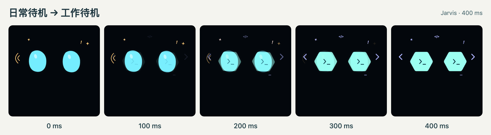

# Jarvis 眼神交付指南 v0.3

2026-11-08。用户已认可 v0.2 的眼神造型。v0.3 在这套造型上加入可打断的渐进过渡，并交付可直接调用的绘制代码、可读数据和硬件参考帧。

## 先看效果

打开 [预览](../prototypes/eyes-design/index.html)，点「演示渐进切换」。11 秒内可以看到 Jarvis 从日常待机转为思考、露出心形眼、回到待机，再进入工作模式。最后一次插话直接转入倾听。勾选「切换慢放 ×3」后，可在两个造型之间暂停，或半途选择另一个模式看它怎样改向。

解压交付包后保持目录结构，预览和导出页可以直接在浏览器中打开。也可以在包根目录运行 `node prototypes/eyes-design/server.mjs`，随后打开 [本地预览](http://127.0.0.1:8768/)。



## 另一个会话从哪里开始

| 任务 | 直接使用的材料 |
| --- | --- |
| 判断一个表情何时合适、屏幕上该保留什么 | [获认可的造型和语义](jarvis-eye-interaction-design.md) |
| 确定同时换状态、情绪、模式的优先级，复现中间帧 | [过渡规范](jarvis-eye-transitions.md)和[毫秒取样器](../design/eyes/transitions.js) |
| 在网页或 Linux 屏上复用原画 | [绘制函数](../design/eyes/artwork.js)、[静帧封装](../design/eyes/frames.js)及[预览渲染实例](../prototypes/eyes-design/index.html) |
| 给原生界面或 MCU 准备图形 | [机器可读清单](../design/eyes/manifest.json)、[素材与坐标说明](../design/eyes/README.md)、[PNG／RGB565 离线导出页](../design/eyes/export-frame.html) |
| 把对话事实和片段情绪合成显示目标 | [已生效会话快照示例](../design/eyes/example-session.mjs)及[可执行验收用例](../tests/eye-handoff.test.mjs) |

清单列出了 24 个状态在四种模式中的 96 个组合，每个组合指向一张 320×240 的 SVG。清单中的英文 ID 用于程序对接。界面文案可以本地化，例如“得意”对应 `proud`。原画、曲线和组合规则分别由 `artwork.js`、`transitions.js` 和过渡规范维护。

## 接入一段真实对话

以英语模式中播出鼓励为例。播放器开始播当前片段时，适配器提交 `phase=speaking`、`mode=english`、已播放片段的字幕和属于它的 `tone=encouraging`。显示器保留“说话”状态，用单眼眨动和一颗星表达鼓励。正常播完时眼睛用 160 ms 收回到倾听。用户在播报途中插话时，同一轮更新就清掉旧字幕和庆祝，立即转成倾听。

1. 会话层先裁决当前 session、turn、response 和 segment。把同一时刻生效的状态与模式作为一份快照提交。使用播放器实际开始／结束事件更新字幕与说话状态。
2. 示例函数 `resolveFace(snapshot, nowMs)` 返回 `{state, mode, status, caption, badges}`。它只采用归属当前播放片段、处于有效期的情绪。实际产品还需由会话层拒绝整份迟到的旧快照。只换字幕时，根据当前片段更新文字即可。
3. 显示器常驻一个取样器。初始化一次，每次目标变化时调用 `setTarget`，每个刷新周期调用 `sample`。同一次更新中绘制两只眼，最后绘制状态和字幕。预览中的 `choose` 与 `paint` 展示了姿态插值、轮廓权重、短时演出和黑屏清理的具体顺序。

```js
import './design/eyes/transitions.js';
const { createTransition } = globalThis.JarvisEyeTransitions;
const timeline = createTransition({ state: 'idle', mode: 'daily' }, 0);
timeline.setTarget({ state: 'idle', mode: 'work' }, 100);
const halfway = timeline.sample(300);
// halfway.layers 给出日常和工作各 0.5。此刻改选英语会接住这一帧。
timeline.setTarget({ state: 'idle', mode: 'english' }, 300);
const frame = timeline.sample(500); // 日常 0.25，工作 0.25，英语 0.5
timeline.setTarget({ state: 'listening', mode: 'english' }, 510, { interrupt: true });
```

## 用在硬件屏上

**有浏览器或图形加速的 Linux 主控。** 复用绘制函数与取样器，参考预览的 `#face` 和字幕层，将控制面板换成业务事件。眼睛共享画布坐标，状态及两行字幕有独立的固定区域。还原画面后用目标屏幕实测首次可见反馈、掉帧和文字可读性。

**使用帧缓冲的 MCU。** 先用离线导出页选择 `listening / work`、320×240，导出一张 PNG 和与驱动字节序一致的 RGB565。PNG 可作视觉对照，整屏 RGB565 为 153,600 字节。先校验色序、眼形比例和字幕留白，再按过渡规则以毫秒取样。内存紧张时可仅缓冲眼区，使用分块刷屏。将旧帧与新帧的 RGB565 解包为颜色分量再混合和量化。需要活动瞳心、符号或粒子时，可按指定时刻导出关键帧，或在设备上移植原画中的图元与动作公式。

用 Node.js 22 或以上，在交付包根目录运行以下命令即可核对素材或生成某一时刻的方屏帧。

```sh
node design/eyes/example-session.mjs
node --test tests/eye-handoff.test.mjs
node design/eyes/export.mjs check
node design/eyes/export.mjs frame excited companion --size square --time 1200 --age 1200 --out celebration.svg
```

更新设计后，可用 `python3 design/eyes/package.py` 从工程重新生成 `output/jarvis-eyes-v0.3.zip`。

## 首次移植验收

- **造型**。将工作倾听、英语说话、喜欢、共情和黑屏分别与对应参考帧对照。再看两种屏幕比例下的双眼与字幕，在实际桌面距离 20、35、50 cm 读中英文。
- **接续**。复现上方 0.5／0.5 中途改向样例。关掉特效再做一次，眼睛的位置、颜色和有孔轮廓仍应平滑交接。
- **演出生命周期**。兴奋时只换模式，同次庆祝按最初起点在约 3.6 秒收尾。插话时旧粒子和字幕当帧清除。会话结束后送入一条旧回复，应继续显示新一轮状态。
- **端侧实测**。记录目标设备、屏幕、色序、刷新时间与内存占用。减弱动画直接采用静态目标。电源、关节、声音和显示由各自驱动上报实际状态。

交给另一个 AI 会话时，可以直接附上整个 ZIP，再写明目标平台、屏幕分辨率、显示驱动，以及这次要接入的业务事件。例如「复用包中的工作模式眼形，在 320×240 屏上实现倾听→思考→说话，展示一次中途插话和一次模式回滚，并用参考帧对照输出。」

## 本次交付验证

2026-11-08 从 ZIP 解压到独立目录后，五项接口测试全部通过。其中一项遍历了 96 个起点与 96 个终点，共 9,216 对，核对权重归一及最终造型。96 张 SVG 与清单均通过逐文件重绘核对。浏览器通过本地 HTTP 实际加载解压版、暂停中间帧、运行插话演示，并导出 153,600 字节的 320×240 RGB565。整个过程的外网请求数为零。样本 PNG 与大端 RGB565 的 76,800 个像素已逐一核对。

v0.3 的验证覆盖参考渲染器、过渡契约和导出格式。目标设备的亮度、可读距离、流畅度，以及屏幕与实际录放音、关节的同步，在硬件与会话集成阶段测量。
